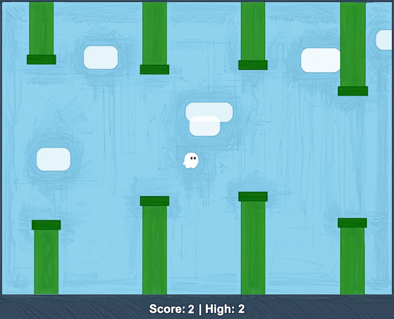

# Flappy Kiro

Initial folder containing support resources for the Flappy Kiro game.

## How to play

Open `index.html` in a browser. No build step or server is needed.

- Click, tap, or press Space (or Up arrow / W) to flap.
- Fly Ghosty through the gaps between the pipes. Each pipe you pass scores a point.
- Touching a pipe or the ground ends the game. Your high score is saved in the browser.

## Example UI

## Resources

- `assets/` - Game audio and sprites
- `img/` - Screenshots and images